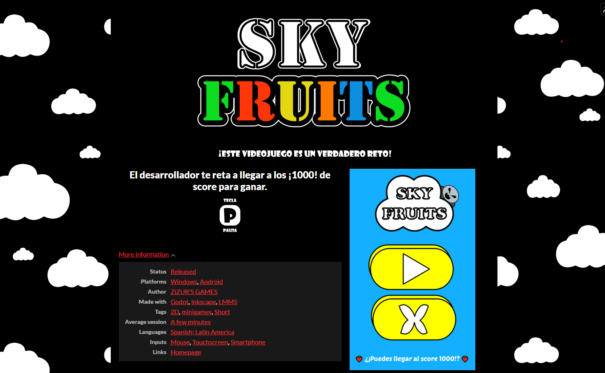

  # Hola, soy Cesar Vazquez `VS`

  **Estudiante de Ingeniería en Sistemas Computacionales · Becario · Desarrollador & Game Dev**

  
  

---

### Sobre mí

- 🎓 Estudiando **Ingeniería en Sistemas Computacionales**.
- 💼 Actualmente desempeñándome como **becario**.
- 🛠️ Interesado en desarrollo de software, bases de datos, reportes, estructuras de datos y creación de videojuegos.

---

### Stack & Tecnologías

  

  
  
  
  

---

### Proyecto Destacado: Sky Fruits

Videojuego desarrollado en **Godot Engine** (`GDScript`), disponible tanto en mi repositorio como en itch.io.

  

  <a href="https://zizurs-games.itch.io/sky-fruits">🎮 Jugar en itch.io</a> ·
  <a href="https://github.com/Zizur8/Sky-Fruits">📂 Ver código en GitHub</a>

---

### Contribuciones

| 📊 Resumen de Actividad |
| :---: |
|      **Aug 29, 2021 - Present**    |

---

  © 2026 Cesar VS

